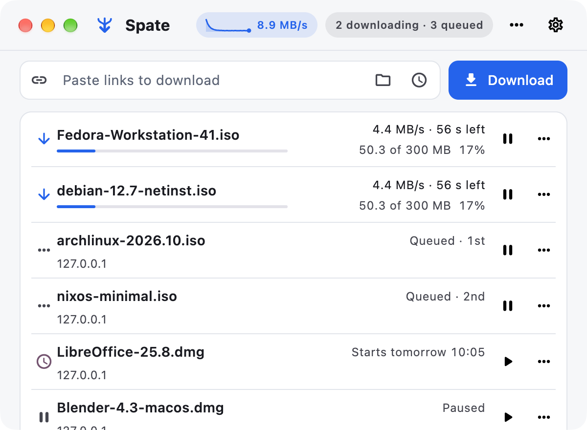

# Spate

**The download manager for macOS and Linux (and Windows) that finishes what your browser starts.**
Many connections per file, resume after anything, hand-off from the browser with your cookies intact, rules that file and schedule downloads for you. One Go core, a thin native-feeling app, free and open source.

## Why Spate

- **Fast where it counts.** Up to 32 connections per file with work-stealing, so a per-connection cap on the server side stops mattering. Resumes after a crash, a sleep, a flaky link or a changed file, and verifies SHA-256 when you give it one.
- **The browser hands over.** The extension catches a download, checks the link is fetchable with your session, and only then takes it; what cannot be re-fetched stays in the browser. Chrome, Brave, Edge, Vivaldi, Firefox and Safari.
- **Set rules once.** Folders by site or by file type, speed limits by time of day, a download window, recurring fetches, scheduled starts.
- **Stays out of the way.** 20 MB for the engine, a menu-bar or tray icon that shows "2 · 43%", notifications when something finishes, and a window with six downloads on screen, not two.
- **Honest about limits.** No DRM, no scraping, nothing that bypasses your ISP. It downloads what you are allowed to fetch, well.

## Install

| Platform | Get |
|---|---|
| macOS | `Spate-<version>.pkg` from the releases page; per-user, no admin password |
| Debian, Ubuntu | `sudo apt install ./spate_<version>_<arch>.deb` |
| Windows | `Spate-Setup-<version>.exe` (silent: `/S`) |
| Command line only | `go build -o spate ./cmd/spate` (Go 1.22+, standard library only) |

Then load the browser extension once: Chrome, Brave, Edge or Vivaldi → `chrome://extensions` → Developer mode → Load unpacked → the `extension` folder the installer printed; Firefox → `about:debugging` → Load Temporary Add-on. The installer registers the native host, so pairing is automatic. Store listings and signed builds are on the way.

## Use

Paste links (one or many), drop them on the window, or press Cmd-V anywhere. Start a download in the browser and choose **Download with Spate**. Pick a folder and a start time from the buttons inside the field; everything else follows the rules in Settings. Arrows, Space and Delete work on the list; right-click any row.

Full guide, shortcuts and troubleshooting: [docs/help.md](docs/help.md). Command line: `spate <url> [-o out] [-n 8] [-resume] [-limit 2M] [-sha256 <hex>]`.

## Build from source

    ./build mac        # Flutter app + core -> dist/macos (.pkg and .zip)
    ./build linux      # Debian package
    ./build windows    # cross-compiled core + NSIS installer
    go test -race ./... && scripts/test/run.sh && (cd apps/flutter && flutter test)

Needs Go 1.22+, Flutter 3.47 and the platform toolchain. Details, installers, footprint measurements and the resume format: [docs/building.md](docs/building.md). Design and delivery: [docs/architecture.md](docs/architecture.md), [docs/delivery.md](docs/delivery.md).

## License

MIT. Copyright (c) 2026 Deepak Lohani.

## Buy me a coffee

Spate is built by one developer and will stay free. If it saves you time, a coffee keeps the next release coming:
**[buymeacoffee.com/dlohani](https://buymeacoffee.com/dlohani)**
