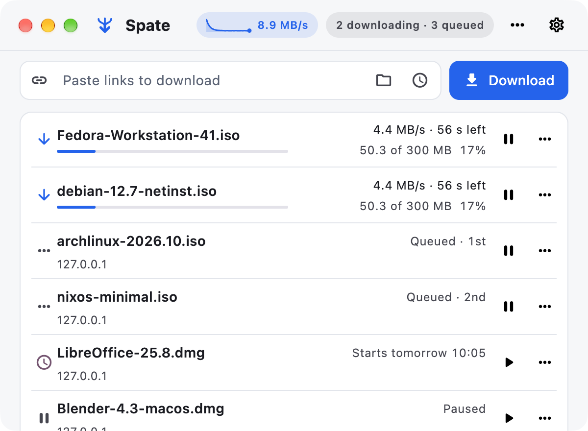

# Spate

<p align="center">
  <a href="https://github.com/dlohani/Spate/releases/latest"></a>
  <a href="https://github.com/dlohani/Spate/actions/workflows/build.yml"></a>
  
  
</p>

<p align="center">
  <strong>The fast, lightweight download manager for macOS, Linux, and Windows that finishes what your browser starts.</strong><br>
  Multi-connection acceleration, rock-solid resume, and seamless browser hand-off with your session intact.
</p>

<p align="center">
  
</p>

---

## Highlights

- ⚡ **Accelerated Downloads** &mdash; Up to 32 parallel connections per file with dynamic work-stealing to bypass server rate caps.
- 🔄 **Resilient Resume** &mdash; Seamlessly recovers after sleep, connection drops, or restarts with optional SHA-256 verification.
- 🌐 **Browser Integration** &mdash; Catch downloads from Chrome, Brave, Edge, and Firefox with cookies and authentication intact. Safari support is experimental.
- 🗂️ **Automated Organization** &mdash; Rule-based folder sorting by domain or file extension, speed limiters, and off-peak scheduling.
- 🪶 **Lightweight Footprint** &mdash; ~20 MB Go engine, native system tray / menu bar integration, and zero bloatware.

---

## Installation

Download the latest release for your platform from the [Releases page](https://github.com/dlohani/Spate/releases/latest). Files are named `spate-<platform>-<version>` (release 1.0.0 used older names: `Spate-1.0.0.pkg`, `Spate-Setup-1.0.0.exe`):

| Platform | Package | Notes |
|:---|:---|:---|
| **macOS** | [`spate-macos-<version>.pkg`](https://github.com/dlohani/Spate/releases/latest) | macOS 12 or later, per-user install (no admin password needed). Releases after 1.0.0 are universal (Apple Silicon and Intel); 1.0.0 itself runs on Apple Silicon only. |
| **Linux** | [`spate-linux-<version>-amd64.deb`](https://github.com/dlohani/Spate/releases/latest) | Debian / Ubuntu (`sudo apt install ./spate-linux-*.deb`) |
| **Windows** | [`spate-windows-<version>-amd64-setup.exe`](https://github.com/dlohani/Spate/releases/latest) | NSIS installer (silent mode: `/S`) |
| **CLI Only** | `git clone https://github.com/dlohani/Spate && cd Spate && go build ./cmd/spate` | Requires Go 1.22+ (standard library only) |

The installers are not code-signed yet, so the operating system warns on first run:

- **macOS**: after the blocked first attempt, open *System Settings* &rarr; *Privacy & Security* and choose *Open Anyway*.
- **Windows**: on the SmartScreen prompt choose *More info* &rarr; *Run anyway*.

Check a download against `SHA256SUMS` from the same release before running it.

### Browser Extension

1. **Chrome / Brave / Edge**: Open `chrome://extensions` &rarr; enable *Developer mode* &rarr; click *Load unpacked* &rarr; select the `extension` folder included with Spate.
2. **Firefox**: Download `spate-extension-firefox-<version>.zip` from the release and unzip it. Open `about:debugging` &rarr; *This Firefox* &rarr; *Load Temporary Add-on* &rarr; select the `manifest.json` inside the unzipped folder. Do not use the `extension` folder installed with Spate for Firefox: it is the Chrome build. Firefox removes a temporary add-on when it restarts, so this step is repeated after each restart until a signed add-on is published.
3. **Safari** (experimental): not included in the release. On a Mac with Xcode, build it from source with `scripts/safari-extension.sh`. It is unsigned, so *Allow Unsigned Extensions* must be enabled in Safari's Develop menu each time Safari starts, and Spate must already be running because Safari cannot start it.

---

## Command Line (CLI)

Spate includes a standalone, dependency-free CLI tool:

```bash
# Basic download
spate https://example.com/archive.iso

# Accelerated download with 16 connections and SHA-256 validation
spate -n 16 -sha256 <expected-hash> -o archive.iso https://example.com/archive.iso

# Resume an interrupted download
spate -resume https://example.com/archive.iso

# Rate limit transfer speed
spate -limit 5M https://example.com/large-dataset.tar.gz
```

---

## Building from Source

Prerequisites: **Go 1.22+** and **Flutter 3.x** (optional, for desktop GUI).

```bash
# Build desktop app and core for current OS
./build mac       # macOS (.pkg in dist/macos)
./build linux     # Linux (.deb in dist/linux)
./build windows   # Windows (.exe in dist/windows)

# Run test suite
go test -race ./...
```

For architecture notes and protocol specifications, see [docs/architecture.md](docs/architecture.md).

---

## License

Distributed under the [MIT License](LICENSE). Copyright &copy; 2026 Deepak Lohani.

---

## Support

Spate is an independent, open-source project. If it saves you time or bandwidth, consider supporting its development:

[](https://buymeacoffee.com/dlohani)
